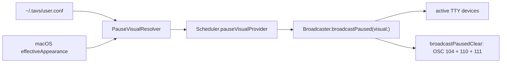

# Pause Foreground Control - Specification

**Status:** Final
**Created:** 2026-05-29
**Last Updated:** 2026-05-29
**Version:** 1.0.0
**Author:** Codex

---

## Table of Contents

1. [Project Overview](#project-overview)
2. [Goals & Success Criteria](#goals--success-criteria)
3. [Architecture & Design](#architecture--design)
4. [Decisions & Rationale](#decisions--rationale)
5. [Implementation Phases](#implementation-phases)
6. [Constraints & Boundaries](#constraints--boundaries)
7. [Rejected Alternatives](#rejected-alternatives)
8. [Verification Strategy](#verification-strategy)
9. [Open Questions](#open-questions)
10. [Research Notes](#research-notes)
11. [Review Notes](#review-notes)

---

## Project Overview

**Name:** Pause Foreground Control

**Summary:** TAVS currently paints a distinctive paused/muted terminal background
from the macOS menu-bar app, but it leaves the terminal default foreground text
color untouched. This feature extends the paused visual to also set and restore
the terminal default foreground color, giving Ghostty users stronger appearance
control during manual pause, outside-schedule mute, and quiet-period breaks.

**Core Purpose:** Make every muted TAVS terminal visually unmistakable while
preserving fast resume, user tab titles, and normal active-state text coloring.

---

## Goals & Success Criteria

| Goal | Success Criterion | Priority |
|------|-------------------|----------|
| Set pause foreground | Entering any muted state emits OSC 10 with the configured foreground color. | Must Have |
| Restore foreground | Leaving mute emits OSC 110 before pending state bytes are replayed. | Must Have |
| Keep pause visuals configurable | Preferences exposes dark/light pause foreground controls beside pause backgrounds. | Must Have |
| Preserve current pause semantics | All muted reasons continue to share one visual path and no pause method emits OSC 0. | Must Have |
| Avoid normal-state disruption | Processing, permission, complete, idle, compacting, subagent, and tool-error states do not set foreground in v1. | Must Have |
| Live repaint on persisted change | A persisted pause foreground/background or appearance change while muted repaints active TTYs on the next scheduler evaluation. | Must Have |
| Safe malformed config | Malformed pause foreground/background values fall back to appearance-correct defaults before OSC bytes are built. | Must Have |
| Document terminal limits | Docs clearly state that explicit TrueColor app output can override OSC 10. | Must Have |
| Leave palette extensible | The model can grow to optional pause palette control later, but v1 does not implement it. | Should Have |

---

## Architecture & Design

### Overview

Pause visual rendering is Swift-owned today. Shell hooks paint active agent
states through `src/core/trigger.sh`, but the muted visual is broadcast directly
by the macOS app to registered TTYs. This feature must therefore extend the
Swift pause path first, not the shell trigger path.

The implementation adds a small pause-specific value type, `PauseVisual`, and
passes that value through the existing scheduler and broadcaster dependency
chain. `PauseVisual` is the sanitized boundary: by the time it exists, both
colors are valid `#RRGGBB` values selected for the current macOS appearance. The
scheduler compares the whole value for idempotent repaint, and the broadcaster
only serializes it into OSC bytes.



### Key Components

| Component | Purpose | Location |
|-----------|---------|----------|
| `PauseVisual` | Sanitized value type for pause background and foreground colors. | `src/macos/TAVSApp/Sources/TAVSApp/` |
| Pause visual resolver | Reads `user.conf`, selects dark/light values, constructs `PauseVisual`. | `src/macos/TAVSApp/Sources/TAVSApp/TAVSApp.swift` |
| `Scheduler` | Evaluates mute state, compares last painted visual, triggers repaint. | `src/macos/TAVSApp/Sources/TAVSApp/Scheduler.swift` |
| `Broadcaster` | Emits pause and pause-clear OSC bytes to registered TTYs. | `src/macos/TAVSApp/Sources/TAVSApp/Broadcaster.swift` |
| `UserConfStore` | Stores curated pause foreground keys and defaults. | `src/macos/TAVSApp/Sources/TAVSApp/UserConfStore.swift` |
| `PreferencesView` | Adds dark/light foreground color pickers in "Paused State". | `src/macos/TAVSApp/Sources/TAVSApp/PreferencesView.swift` |

### Current State

Current paused behavior:

- `Scheduler.loadAndEvaluate()` calls `broadcastPaused(backgroundColor:)` on
  active -> muted transitions.
- `Scheduler.loadAndEvaluate()` calls `broadcastPausedClear()` and then
  `broadcast()` on muted -> active transitions.
- `Broadcaster.broadcastPaused(backgroundColor:)` emits:
  - OSC 104, reset palette
  - OSC 11, set terminal background
  - OSC 1337 `SetBackgroundImageFile=`, clear iTerm2 background image
- `Broadcaster.broadcastPausedClear()` emits:
  - OSC 104, reset palette
  - OSC 111, reset terminal background
- No paused path emits OSC 0 title bytes.
- Existing pause background keys are:
  - `TAVS_PAUSE_BG_DARK`, default `#3A3A3A`
  - `TAVS_PAUSE_BG_LIGHT`, default `#D0D0D0`

### Target Behavior

On entering any muted state, TAVS must emit one pause visual payload to every
active TTY:

```text
OSC 104                 reset ANSI palette
OSC 10;<foreground>     set terminal default foreground
OSC 11;<background>     set terminal background
OSC 1337;SetBackgroundImageFile=  clear iTerm2 background image
```

On leaving mute, TAVS must emit one pause-clear payload before replaying pending
OSC bytes:

```text
OSC 104                 reset ANSI palette
OSC 110                 reset terminal default foreground
OSC 111                 reset terminal background
```

The existing use of BEL as a Swift broadcaster terminator may continue because
Ghostty accepts BEL and ST. New shell helper work is out of scope for v1.

### Configuration

Add two curated app-owned config keys:

```bash
TAVS_PAUSE_FG_DARK="#F2F2F2"
TAVS_PAUSE_FG_LIGHT="#202020"
```

The foreground defaults are intentionally neutral soft-contrast colors:

- `#F2F2F2` gives readable text over the dark pause background `#3A3A3A`
  without the glare of pure white.
- `#202020` gives readable text over the light pause background `#D0D0D0`
  without the harshness of pure black.

The config keys live beside the existing pause background keys in
`src/config/user.conf.template` and `UserConfStore`. They are app-owned, not
normal shell theme variables in `src/config/defaults.conf`.

### Sanitization and Fallback Ownership

`PauseVisual` owns malformed-color fallback. The resolver passes the raw stored
values plus appearance-specific defaults into `PauseVisual`; the value type
stores only valid `#RRGGBB` strings. `Broadcaster` must not choose fallback
colors because it has no macOS appearance context.

Fallbacks are:

| Field | Dark fallback | Light fallback |
|-------|---------------|----------------|
| Background | `UserConfStore.defaultPauseBgDark` (`#3A3A3A`) | `UserConfStore.defaultPauseBgLight` (`#D0D0D0`) |
| Foreground | `UserConfStore.defaultPauseFgDark` (`#F2F2F2`) | `UserConfStore.defaultPauseFgLight` (`#202020`) |

This intentionally fixes the current background sanitizer limitation where
malformed background values always fall back to dark grey.

### Preferences UI

The "Paused State" section in `PreferencesView` should show four color pickers:

- Dark mode background
- Dark mode foreground
- Light mode background
- Light mode foreground

The copy should describe the foreground as terminal default foreground while
paused. It must not promise that every colored character from every terminal app
will be recolored.

### Idempotence

`Scheduler` currently tracks `lastPaintedPauseColor: String?`. This must become
`lastPaintedPauseVisual: PauseVisual?`. While still muted:

- A background-only change must repaint.
- A foreground-only change must repaint.
- No change must not repaint.

On unmute, the scheduler clears `lastPaintedPauseVisual` after
`broadcastPausedClear()` and `broadcast()`.

Repaint is triggered by scheduler evaluations, not by intermediate color picker
drag state. A persisted `user.conf` save, heartbeat, wake notification, or
schedule transition can cause a reevaluation. If macOS appearance changes while
already muted, repaint on the next scheduler evaluation is acceptable for v1;
immediate appearance-change observation is out of scope.

Terminals that register after mute has already begun are covered by the same
bounded scheduler behavior. The app already pre-registers running agents at
startup and evaluates on heartbeat. V1 does not add an active-tty file watcher;
newly registered TTYs during an existing mute may receive pause paint on the
next scheduler evaluation.

---

## Decisions & Rationale

### D01: Muted-state scope

**Question:** Which muted states should get foreground recoloring?

**Options Considered:**
- A) All muted states - manual pause, schedule mute, and quiet-period breaks
  share one visual system.
- B) Breaks only - only quiet periods get foreground recoloring.
- C) Distinct by reason - manual pause, schedule mute, and breaks can each have
  different visuals.

**Decision:** A) All muted states.

**Reasoning:** Current code keys visual broadcast off `result.muted`, not
`result.reason`. Keeping one visual path avoids reason-aware branching and keeps
the feature aligned with existing architecture.

### D02: First-implementation scope

**Question:** What should "all state colors" mean for the first implementation?

**Options Considered:**
- A) Pause now, extensible - implement pause foreground now with a value shape
  that can later support all states.
- B) All states now - implement foreground control for every shell-driven state.
- C) Full visual profiles - implement background, foreground, and palette
  profiles for every state now.

**Decision:** A) Pause now, extensible.

**Reasoning:** The user clarified that normal state font colors should be off by
default and left to normal terminal/app coloring. A pause-specific `PauseVisual`
keeps v1 scoped while leaving a clean extension point.

### D03: User control surface

**Question:** How should users control pause foreground colors?

**Options Considered:**
- A) Color pickers - add dark/light foreground keys and Preferences controls.
- B) Auto contrast - compute foreground from background automatically.
- C) Config only - expose raw `user.conf` keys without UI.

**Decision:** A) Color pickers.

**Reasoning:** The existing pause background feature already uses Preferences
color pickers. Foreground belongs beside those controls so users can control the
total muted appearance without hand-editing config.

### D04: Active-state foreground defaults

**Question:** If active states are included now or later, how should foregrounds
be determined by default?

**Options Considered:**
- A) Auto contrast.
- B) Theme-defined.
- C) Terminal default.

**Decision:** C) Terminal default for v1.

**Reasoning:** Active-state foreground control is out of scope. Normal
processing, permission, complete, idle, compacting, subagent, and tool-error
states must not start changing foreground text in this feature.

### D05: Preferences surface size

**Question:** How much should appear in Preferences in the first implementation?

**Options Considered:**
- A) Pause controls only.
- B) All state pickers.
- C) Advanced editor.

**Decision:** A) Pause controls only.

**Reasoning:** Foreground control is required only for the paused visual in v1.
Showing all state pickers would imply a broader feature that is intentionally
out of scope.

### D06: Pause palette policy

**Question:** Should pause mode also override ANSI palette colors?

**Options Considered:**
- A) No palette override.
- B) Optional palette.
- C) Palette always.

**Decision:** Extension only for v1, no palette implementation.

**Reasoning:** The user initially preferred optional palette support, then chose
"extension only" for the concrete shape. V1 keeps existing OSC 104 reset behavior
and does not add pause palette config or UI. `PauseVisual` may grow a palette
field later.

### D07: Foreground fallback behavior

**Question:** What should happen when no pause foreground is configured?

**Options Considered:**
- A) Fixed defaults.
- B) Auto contrast from background.
- C) Do not set foreground unless explicitly configured.

**Decision:** A) Fixed defaults.

**Reasoning:** Fixed defaults are predictable, documentable, and match the
existing pause background approach. They avoid hidden color math while ensuring
the feature works immediately after update.

### D08: Appearance promise

**Question:** How should docs describe the effect on terminal appearance?

**Options Considered:**
- A) Honest strong control.
- B) Total appearance.
- C) Conservative optional tinting.

**Decision:** A) Honest strong control.

**Reasoning:** Ghostty supports OSC 10/110, but explicit TrueColor output can
override default foreground. Documentation must state that TAVS controls default
foreground/background, not every explicitly colored cell.

### D09: Fixed foreground values

**Question:** Which fixed foreground defaults should the spec choose?

**Options Considered:**
- A) Soft contrast, `#F2F2F2` on dark pause and `#202020` on light pause.
- B) Max contrast, `#FFFFFF` and `#000000`.
- C) Theme text values.

**Decision:** A) Soft contrast.

**Reasoning:** Soft contrast is readable while less harsh than pure black/white.
It also remains neutral across the current default pause backgrounds.

### D10: Core model name and scope

**Question:** What should the core visual model be called and scoped as?

**Options Considered:**
- A) `PauseVisual`.
- B) `VisualStyle`.
- C) No new type.

**Decision:** A) `PauseVisual`.

**Reasoning:** A pause-specific type prevents premature generalization while
avoiding another round of parameter widening when pause visuals gain fields.

### D11: Malformed-color fallback owner

**Question:** Where should malformed pause color fallback be resolved?

**Options Considered:**
- A) `PauseVisual` value construction.
- B) `Broadcaster` payload construction.
- C) Separate duplicate checks in resolver and broadcaster.

**Decision:** A) `PauseVisual` value construction.

**Reasoning:** `Broadcaster` has no macOS appearance context, so it cannot choose
appearance-correct fallbacks. A sanitized value boundary makes fallback behavior
testable and prevents raw malformed config from reaching OSC serialization.

### D12: Appearance changes while muted

**Question:** What happens if macOS dark/light appearance changes while TAVS is
already muted?

**Options Considered:**
- A) Repaint on the next scheduler evaluation.
- B) Add immediate macOS appearance-change observation.
- C) Wait until the next mute cycle.

**Decision:** A) Repaint on the next scheduler evaluation.

**Reasoning:** The existing scheduler already reevaluates on heartbeat,
file-watch, wake, and transitions. Adding a new app appearance observer would be
extra scope; waiting until the next mute cycle would leave a potentially poor
foreground/background pair in place too long.

### D13: New TTYs during mute

**Question:** What happens when a terminal registers after mute has already
started?

**Options Considered:**
- A) Paint on the next scheduler evaluation.
- B) Watch active-ttys and repaint immediately.
- C) Intentionally unsupported.

**Decision:** A) Paint on the next scheduler evaluation.

**Reasoning:** An active-tty watcher is separate infrastructure and not required
to add foreground control. The bounded heartbeat behavior matches the existing
scheduler model and avoids expanding this feature into live TTY registry
monitoring.

### D14: Repaint trigger boundary

**Question:** What counts as a pause visual change while muted?

**Options Considered:**
- A) Persisted config or appearance value at scheduler evaluation time.
- B) Every intermediate ColorPicker drag update.
- C) Only the next mute cycle.

**Decision:** A) Persisted config or appearance value at scheduler evaluation
time.

**Reasoning:** Preferences currently saves on view disappearance. Repainting on
persisted state avoids continuous TTY churn during color dragging while still
supporting live updates after a saved config edit.

---

## Implementation Phases

### Phase 1: Pause visual model and config store

**Scope:** Add the pause foreground configuration surface in Swift data models,
without changing broadcaster output yet.

**Depends On:** Existing `UserConfStore` pause background accessors and
`PreferencesView` color helper behavior.

**Inputs:**
- Current pause background defaults and accessors in `UserConfStore`.
- Existing color parsing and `hexString()` helpers in `PreferencesView`.

**Outputs:**
- `PauseVisual` value type with `backgroundColor` and `foregroundColor`.
- `PauseVisual` validates both fields and falls back to appearance-specific
  defaults before storage.
- `UserConfStore.defaultPauseFgDark == "#F2F2F2"`.
- `UserConfStore.defaultPauseFgLight == "#202020"`.
- `pauseFgDark` and `pauseFgLight` accessors.
- `TAVS_PAUSE_FG_DARK/LIGHT` documented in `user.conf.template`.

**Acceptance Criteria:**
- [ ] Missing foreground keys return `nil` from `UserConfStore` accessors.
- [ ] Foreground defaults are available as Swift constants.
- [ ] Malformed foreground and background values are normalized by `PauseVisual`
  using the correct appearance-specific defaults.
- [ ] Saving foreground keys preserves unrelated `user.conf` lines.
- [ ] `user.conf.template` documents foreground keys beside pause background keys.

**Verification:**
- [ ] Add or extend `UserConfStoreTests` for foreground round-trip and defaults.

### Phase 2: Resolver, scheduler, and broadcaster behavior

**Scope:** Make the macOS app resolve, compare, emit, and clear foreground
colors for every muted state.

**Depends On:** Phase 1.

**Inputs:**
- `PauseVisual`.
- Existing `PauseColorResolver.resolve(userConfURL:)`.
- Existing `BroadcasterProtocol.broadcastPaused(backgroundColor:)`.

**Outputs:**
- A resolver that returns `PauseVisual`.
- `Scheduler` uses `pauseVisualProvider: () -> PauseVisual`.
- `Scheduler` tracks `lastPaintedPauseVisual`.
- `Broadcaster.broadcastPaused(visual:)` emits OSC 10 and OSC 11.
- `Broadcaster.broadcastPausedClear()` emits OSC 110 and OSC 111.

**Acceptance Criteria:**
- [ ] Active -> muted writes one pause payload including foreground.
- [ ] Muted -> active writes foreground reset before pending replay.
- [ ] Foreground-only config changes while muted repaint once.
- [ ] Unchanged foreground/background across re-evaluations do not repaint.
- [ ] Appearance changes while muted repaint on the next scheduler evaluation.
- [ ] Newly registered TTYs during mute are documented as repainting no later
  than the next scheduler evaluation.
- [ ] No broadcaster pause method emits OSC 0.
- [ ] Existing `OSC 1337;SetBackgroundImageFile=` pause image clearing remains
  in the paused payload.

**Verification:**
- [ ] Add `BroadcasterTests` for OSC 10, OSC 110, malformed foreground fallback,
  and no OSC 0.
- [ ] Add `SchedulerTests` for foreground repaint and idempotence.

### Phase 3: Preferences and documentation

**Scope:** Expose foreground controls in the app UI and document behavior,
limits, and verification.

**Depends On:** Phase 2.

**Inputs:**
- Existing "Paused State" section in `PreferencesView`.
- Existing docs in `docs/reference/macos-menubar-app.md`,
  `docs/reference/palette-theming.md`, `docs/reference/testing.md`, and
  `README.md`.

**Outputs:**
- Dark/light foreground color pickers in Preferences.
- Docs list the new `TAVS_PAUSE_FG_DARK/LIGHT` keys.
- Docs state OSC 10/110 behavior and TrueColor limitations.
- Docs state palette override is future work, not v1 behavior.

**Acceptance Criteria:**
- [ ] Preferences loads foreground colors from `UserConfStore` with defaults.
- [ ] Preferences saves changed foreground colors to `user.conf`.
- [ ] Docs do not promise control over explicit TrueColor text.
- [ ] Docs preserve the existing no-title-change pause contract.
- [ ] Docs state appearance changes and newly registered TTYs may repaint on the
  next scheduler evaluation rather than immediately.

**Verification:**
- [ ] Run Swift tests.
- [ ] Manually inspect Preferences to confirm four pause color pickers render.
- [ ] In Ghostty, pause changes default foreground/background and resume resets
  both.

---

## Constraints & Boundaries

### Out of Scope

- No active-state foreground coloring in v1.
- No foreground controls for processing, permission, complete, idle, compacting,
  subagent, tool-error, or reset states.
- No shell `send_osc_fg` helper unless a later spec expands state foregrounds.
- No pause-specific ANSI palette override in v1.
- No distinct visuals per mute reason in v1.
- No title changes during pause or resume.
- No guarantee that explicit 24-bit TrueColor output from terminal apps changes
  color when OSC 10 is emitted.

### Technical Constraints

- The macOS app does not track per-TTY terminal capability metadata. It should
  emit OSC 10/110 the same way it already emits OSC 11/111.
- `Broadcaster` must keep writing directly to active TTY devices through
  `ProcessRunner`; do not route pause visuals through shell hooks.
- Resume ordering remains load-bearing: clear pause visual, replay pending OSC
  bytes, then allow normal shell painting to resume.
- Malformed user config values must not leak raw text into OSC payloads.
- Bad foreground config values must fall back to foreground defaults, not
  background defaults.
- Bad background config values must fall back to appearance-correct background
  defaults. This is an intentional part of the feature because `PauseVisual`
  owns all pause color sanitization.

### Dependencies

- Ghostty support for OSC 10/110 and OSC 11/111.
- Existing TAVS active TTY registry in `/tmp/tavs-$UID/active-ttys`.
- Existing macOS app schedule/mute state evaluation.
- Existing `~/.tavs/user.conf` parser and Preferences color helpers.

---

## Rejected Alternatives

| Alternative | Why Rejected |
|-------------|--------------|
| Breaks only | Current mute visual path is reason-agnostic; reason-specific visuals add branching and config not needed for v1. |
| All state foregrounds now | Normal states are shell-owned and should keep terminal/app default text colors for v1. |
| Full visual profiles now | Too broad for the requested pause/break feature and would require palette/state UI design. |
| Auto contrast foreground defaults | Hidden color math is less predictable than explicit defaults and can surprise users after background edits. |
| Config-only foreground keys | The existing pause background controls are GUI-first; foreground should match that user experience. |
| Always override ANSI palette on pause | Palette changes are more invasive and can surprise users who rely on prompt or app colors. |
| Emit pause title text | Existing history showed title emission can blank or stale user tab titles. The no-OSC-0 invariant remains. |
| Pure black/white foreground defaults | Max contrast is readable but harsher than needed for the default pause backgrounds. |
| Immediate appearance-change observer | It would add new app event plumbing. V1 accepts repaint on the next scheduler evaluation. |
| Active-tty watcher during mute | It would add new registry monitoring infrastructure. V1 accepts repaint on the next scheduler evaluation. |

---

## Verification Strategy

### Code Testing

Run the Swift test suite from the macOS app package:

```bash
cd src/macos/TAVSApp
swift test
```

Required targeted coverage:

- `BroadcasterTests`
  - Pause payload contains `]10;#F2F2F2` or caller-supplied foreground.
  - Pause payload contains `]11;<background>`.
  - Pause-clear payload contains `]110`, `]111`, and `]104`.
  - Paused payload still includes `OSC 1337;SetBackgroundImageFile=`.
  - No pause method emits `]0;` or paused title text.
- `PauseVisual` tests
  - Malformed foreground falls back to the configured foreground default.
  - Malformed background falls back to the appearance-correct background default.
  - Stored colors are always valid `#RRGGBB` strings.
- `SchedulerTests`
  - Active -> muted passes both background and foreground to broadcaster.
  - Foreground-only changes while muted trigger repaint.
  - Background-only changes while muted trigger repaint.
  - Appearance changes while muted repaint on the next scheduler evaluation.
  - Unchanged `PauseVisual` does not repaint across heartbeat/file-watch
    re-evaluations.
  - Muted -> active clears pause visual and replays pending bytes once.
- `UserConfStoreTests`
  - Foreground accessors round-trip.
  - Missing foreground keys return `nil`.
  - Defaults equal `#F2F2F2` and `#202020`.
- Shell regression
  - Verify v1 does not add OSC 10/110 emission to shell-driven active states in
    `src/core/trigger.sh` or `src/core/idle-worker-background.sh`.

### Manual Validation

Manual validation should use Ghostty because Ghostty is the target terminal:

1. Launch TAVS.app.
2. Open Preferences -> Appearance -> Paused State.
3. Confirm dark/light background and foreground color pickers render.
4. Set a visibly different pause foreground.
5. Pause TAVS from the menu or CLI.
6. Confirm default terminal text foreground changes in Ghostty.
7. Resume TAVS.
8. Confirm default foreground and background reset.

### Documentation Validation

- Confirm docs mention OSC 10/110 and OSC 11/111.
- Confirm docs state TrueColor limitations.
- Confirm docs do not imply v1 controls normal active-state foregrounds.
- Confirm docs do not imply v1 implements pause palette overrides.

---

## Open Questions

None for v1. Palette overrides and active-state foregrounds are explicitly
future work, not unresolved requirements.

---

## Research Notes

Research artifacts from discovery:

- `/tmp/explore-tavs-pause-fg-architecture-20260529.md`
- `/tmp/explore-tavs-pause-fg-current-state-20260529.md`
- `/tmp/explore-tavs-pause-fg-tests-config-20260529.md`
- `/tmp/ghostty-osc-foreground-research-20260529_103118.md`

Key external facts:

- Ghostty documents OSC 10 as dynamic foreground color.
- Ghostty documents OSC 110 as foreground reset.
- Ghostty documents OSC 11/111 as background set/reset.
- Ghostty documents OSC 4/104 as palette set/reset.
- Ghostty accepts BEL and ST terminators; new code should generally prefer ST,
  but the existing Swift broadcaster uses BEL successfully for current pause
  sequences.

Primary Ghostty references:

- https://ghostty.org/docs/vt/osc/1x
- https://ghostty.org/docs/vt/osc/11x
- https://ghostty.org/docs/vt/reference
- https://ghostty.org/docs/vt/concepts/colors
- https://ghostty.org/docs/vt/concepts/sequences

---

## Review Notes

**Reviewed by:** gemini-reviewer, codex-reviewer
**Date:** 2026-05-29

### Changes from Review

- Made `PauseVisual` the explicit owner of color validation and fallback.
- Added appearance-correct background fallback as intentional v1 scope.
- Added bounded behavior for macOS appearance flips while muted.
- Added bounded behavior for TTYs that register after mute starts.
- Defined repaint triggers as persisted config/appearance values observed during
  scheduler evaluation, not intermediate ColorPicker drag events.
- Added verification for shell active-state non-disruption and existing iTerm2
  background-image clear behavior.

### Accepted Risks

- Newly registered TTYs during an existing mute and macOS appearance changes
  while muted may repaint on the next scheduler evaluation rather than
  immediately. This avoids adding active-tty or appearance observers in v1.
- Preferences persistence remains partly manual-verified because the app has no
  SwiftUI UI test target or extracted view-model seam today.
