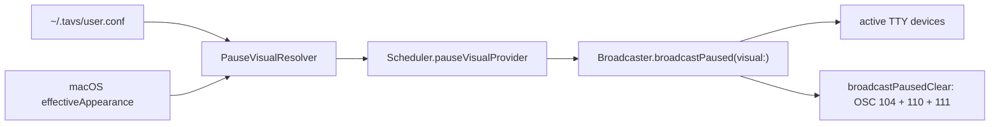

# Pause Foreground Control - Specification

**Status:** Final
**Created:** 2026-05-29
**Last Updated:** 2026-05-29
**Version:** 1.2.0
**Author:** Codex

---

## Table of Contents

1. [Project Overview](#project-overview)
2. [Goals & Success Criteria](#goals--success-criteria)
3. [Product Context](#product-context)
4. [Architecture & Design](#architecture--design)
5. [Behavior Contracts](#behavior-contracts)
6. [Decisions & Rationale](#decisions--rationale)
7. [Implementation Phases](#implementation-phases)
8. [Constraints & Boundaries](#constraints--boundaries)
9. [Rejected Alternatives](#rejected-alternatives)
10. [Verification Strategy](#verification-strategy)
11. [Open Questions](#open-questions)
12. [Research Notes](#research-notes)
13. [Review Notes](#review-notes)

---

## Project Overview

**Name:** Pause Foreground Control

**Summary:** TAVS currently paints a distinctive paused/muted terminal background
from the macOS menu-bar app, but it leaves the terminal default foreground text
color untouched. This feature extends the paused visual to also set and reset
the terminal default foreground color, giving Ghostty users stronger appearance
control during manual pause, outside-schedule mute, and quiet-period breaks.

**Core Purpose:** Make every muted TAVS terminal visually unmistakable while
preserving fast resume, user tab titles, and normal active-state text coloring.

---

## Goals & Success Criteria

### Must Have

- **Set pause foreground:** entering any muted state emits OSC 10 with the
  configured foreground color.
- **Reset foreground:** leaving mute emits OSC 110 before TAVS-owned pending
  state bytes are replayed.
- **Keep pause visuals configurable:** Preferences exposes dark/light pause
  foreground controls beside pause backgrounds.
- **Preserve current pause semantics:** all muted reasons continue to share one
  visual path and no pause method emits OSC 0.
- **Avoid normal-state disruption:** active shell states do not set foreground
  in v1.
- **Live repaint on persisted change:** a persisted pause visual change while
  muted repaints active TTYs through the file-watch path; appearance flips and
  new TTYs use the documented heartbeat-bounded path unless v1 adds observers.
- **Safe absent and malformed config:** absent or malformed pause foregrounds
  fall back to a readable foreground for the resolved background before OSC
  bytes are built.
- **Document terminal limits:** docs state that explicit TrueColor app output
  can override OSC 10.
- **Support team handoff:** the spec describes product behavior, ownership
  boundaries, phases, and verification gates without prior conversation context.
- **Provide direct feedback loops:** implementers can verify visible Ghostty
  behavior and inspect OSC-byte contracts through tests.

### Should Have

- **Leave palette extensible:** the model can grow to optional pause palette
  control later, but v1 does not implement it.

---

## Product Context

### User Problem

TAVS is used to manage many concurrent AI-agent terminal sessions. Background
colors already make session state glanceable, but a break or pause period should
feel more definitive than another state tint. During scheduled quiet periods or
manual pause, users want the terminal to visually communicate: "TAVS is muted
right now; this session is not actively signaling normal state changes."

The current paused background is useful, but it does not control the default
text color. In Ghostty, adding default foreground control lets the muted state
feel like a complete temporary appearance mode while still leaving normal agent
states alone.

### Primary Users

- **Multi-session agent operator:** needs paused/break terminals to be visible
  at a glance across many Ghostty windows. Success means paused terminals have
  both background and default text color changed.
- **TAVS maintainer:** needs foreground control without destabilizing scheduling,
  titles, or active state coloring. Success means existing focused tests keep
  passing with targeted additions.
- **Future implementer:** needs exact scope and ownership boundaries. Success
  means implementation planning can start from this SPEC without re-opening
  decisions.

### User Workflows

1. **Manual pause:** User pauses TAVS from the menu bar or CLI. Existing active
   agent terminals change to the configured pause background and foreground.
2. **Scheduled break:** A quiet-period break begins. The same pause visual is
   applied because all muted reasons share one visual contract.
3. **Resume:** User resumes or schedule re-enters an active window. TAVS resets
   foreground/background to terminal defaults and replays TAVS-owned pending
   state bytes.
4. **Customize:** User opens Preferences -> Appearance -> Paused State and
   adjusts foreground/background colors for dark and light macOS appearance.
5. **Recover from bad config:** If `user.conf` contains malformed pause colors,
   TAVS falls back to documented defaults and still paints a valid pause visual.

### Product Principles

- **Pause means temporary ownership:** While muted, TAVS can own default
  foreground and background. When unmuted, it must reset both to terminal
  defaults.
- **Titles remain sacred:** Pause must not emit OSC 0 or blank/stale user-set
  terminal tab names.
- **Normal states stay normal:** This feature must not change text colors for
  processing, permission, complete, idle, compacting, subagent, or tool-error.
- **Truthful control claim:** TAVS controls terminal default foreground and
  background. Explicit TrueColor app output can still override foreground.
- **No third-party state snapshot:** V1 does not preserve runtime OSC 10/11
  overrides emitted by other tools before pause.
- **Boring config behavior:** Bad color config should degrade to known safe
  fallbacks, not leak raw strings into terminal control sequences.

---

## Architecture & Design

### Overview

Pause visual rendering is Swift-owned today. Shell hooks paint active agent
states through `src/core/trigger.sh`, but the muted visual is broadcast directly
by the macOS app to registered TTYs. This feature must therefore extend the
Swift pause path first, not the shell trigger path.

The implementation adds a small pause-specific value type, `PauseVisual`, and
passes that value through the existing scheduler and broadcaster dependency
chain. `PauseVisual` is the sanitized boundary: by the time it exists, both
colors are valid `#RRGGBB` values selected for the current macOS appearance. The
scheduler compares the whole value for idempotent repaint, and the broadcaster
only serializes it into OSC bytes.



### Key Components

- **`PauseVisual`**
  - Purpose: sanitized value type for pause background and foreground colors.
  - Location: `src/macos/TAVSApp/Sources/TAVSApp/`
- **Pause visual resolver**
  - Purpose: reads `user.conf`, selects dark/light values, constructs
    `PauseVisual`.
  - Location: `src/macos/TAVSApp/Sources/TAVSApp/TAVSApp.swift`
- **`Scheduler`**
  - Purpose: evaluates mute state, compares last painted visual, triggers
    repaint.
  - Location: `src/macos/TAVSApp/Sources/TAVSApp/Scheduler.swift`
- **`Broadcaster`**
  - Purpose: emits pause and pause-clear OSC bytes to registered TTYs.
  - Location: `src/macos/TAVSApp/Sources/TAVSApp/Broadcaster.swift`
- **`UserConfStore`**
  - Purpose: stores curated pause foreground keys and shell-parity config
    semantics.
  - Location: `src/macos/TAVSApp/Sources/TAVSApp/UserConfStore.swift`
- **`PreferencesView`**
  - Purpose: adds dark/light foreground color pickers in "Paused State".
  - Location: `src/macos/TAVSApp/Sources/TAVSApp/PreferencesView.swift`

### Ownership Boundaries

- **Muted/pause visual state:** Swift macOS app. It broadcasts directly to
  registered TTYs.
- **Active agent state visuals:** shell hooks. Foreground control for these
  states is out of scope for v1.
- **Pause color parsing and defaults:** `PauseVisual` plus `UserConfStore`.
  Values are sanitized and foreground fallbacks are resolved before
  `Broadcaster` sees them.
- **Pause repaint timing:** `Scheduler`. Repaints happen on scheduler
  evaluations while muted.
- **User-facing controls:** Preferences Appearance tab. V1 exposes pause-only
  controls.
- **Terminal compatibility claim:** documentation. Ghostty is the target;
  non-Ghostty terminals are best-effort.

### Palette Reset Rationale

The current pause broadcaster already emits OSC 104 palette reset on pause entry
and pause clear. V1 preserves that behavior to avoid mixing a foreground feature
with a separate pause-cleanup policy change. This is not a pause palette
override: v1 does not emit OSC 4 palette-setting sequences and does not expose
pause palette controls.

The preserved OSC 104 behavior must be documented as existing pause cleanup. A
future palette-focused spec may revisit whether TAVS should keep, remove, or
make that reset configurable.

### Required User-Visible Outcomes

- **Enter manual pause:** existing agent terminals switch to pause background and
  default text color. Verify with a direct Ghostty visual check.
- **Enter quiet-period break:** the same pause visual appears; no separate break
  style is expected. Verify through schedule or CLI pause checks.
- **Resume:** terminal foreground/background reset to terminal defaults, and
  pending TAVS state paint can apply the latest TAVS-owned state. Verify
  visually and through broadcaster tests.
- **Change pause foreground while muted:** the new persisted value appears via
  the file-watch-triggered scheduler evaluation. Verify through Preferences or
  `user.conf`.
- **Malformed foreground config:** pause still paints using documented fallback.
  Verify with unit tests and a manual bad-config check.
- **Normal processing state fires:** shell active-state paths emit no foreground
  OSC. Verify with shell regression coverage.

### Current State

Current paused behavior:

- `Scheduler.loadAndEvaluate()` calls `broadcastPaused(backgroundColor:)` on
  active -> muted transitions.
- `Scheduler.loadAndEvaluate()` calls `broadcastPausedClear()` and then
  `broadcast()` on muted -> active transitions.
- `Broadcaster.broadcastPaused(backgroundColor:)` emits:
  - OSC 104, reset palette
  - OSC 11, set terminal background
  - OSC 1337 `SetBackgroundImageFile=`, clear iTerm2 background image
- `Broadcaster.broadcastPausedClear()` emits:
  - OSC 104, reset palette
  - OSC 111, reset terminal background
- No paused path emits OSC 0 title bytes.
- Existing pause background keys are:
  - `TAVS_PAUSE_BG_DARK`, default `#3A3A3A`
  - `TAVS_PAUSE_BG_LIGHT`, default `#D0D0D0`

### Target Behavior

On entering any muted state, TAVS must emit one pause visual payload to every
active TTY:

```text
OSC 104                 reset ANSI palette
OSC 10;<foreground>     set terminal default foreground
OSC 11;<background>     set terminal background
OSC 1337;SetBackgroundImageFile=  clear iTerm2 background image
```

On leaving mute, TAVS must emit one pause-clear payload before replaying pending
TAVS-owned OSC bytes:

```text
OSC 104                 reset ANSI palette
OSC 110                 reset terminal default foreground
OSC 111                 reset terminal background
```

This reset does not snapshot or restore runtime OSC 10/11 colors emitted by
other tools before pause. V1 intentionally resets terminal defaults and then
replays only TAVS-owned pending state.

The existing use of BEL as a Swift broadcaster terminator may continue because
Ghostty accepts BEL and ST. New shell helper work is out of scope for v1.

### Configuration

Add two curated app-owned config keys:

```bash
TAVS_PAUSE_FG_DARK="#F2F2F2"
TAVS_PAUSE_FG_LIGHT="#202020"
```

These template values are intentionally neutral soft-contrast colors for the
default pause backgrounds:

- `#F2F2F2` gives readable text over the dark pause background `#3A3A3A`
  without the glare of pure white.
- `#202020` gives readable text over the light pause background `#D0D0D0`
  without the harshness of pure black.

They are template defaults, not the only runtime fallback. Existing users may
already have custom `TAVS_PAUSE_BG_DARK/LIGHT` values without foreground keys.
For absent or malformed foreground keys, `PauseVisual` must derive a readable
foreground from the resolved pause background rather than blindly applying the
fixed template value.

The minimum readability threshold is WCAG contrast ratio 4.5:1 for normal text.
This gives implementers one exact rule while keeping the feature limited to
fallback selection, not full theme accessibility enforcement.

The derivation is deterministic:

- First try the soft candidates `#F2F2F2` and `#202020`.
- Pick the candidate with the higher contrast against the resolved background
  when it meets the minimum readability threshold.
- If neither soft candidate is readable enough, pick `#FFFFFF` or `#000000`,
  whichever has higher contrast against the resolved background.
- Do not persist this derived fallback into `user.conf` unless the user
  explicitly changes that foreground control.

Valid configured foreground keys always win, even if the user chooses a low
contrast color. The readability safety guarantee applies to absent and malformed
foreground values, not to deliberate valid user choices.

The config keys live beside the existing pause background keys in
`src/config/user.conf.template` and `UserConfStore`. They are app-owned, not
normal shell theme variables in `src/config/defaults.conf`.

### Sanitization and Fallback Ownership

`PauseVisual` owns malformed-color fallback. The resolver passes the raw stored
values plus appearance-specific background defaults into `PauseVisual`; the
value type stores only valid `#RRGGBB` strings. `Broadcaster` must not choose
fallback colors because it has no macOS appearance or contrast context.

Fallbacks are:

- **Background, dark:** `UserConfStore.defaultPauseBgDark` (`#3A3A3A`)
- **Background, light:** `UserConfStore.defaultPauseBgLight` (`#D0D0D0`)
- **Foreground, explicit valid key:** configured user value.
- **Foreground, absent or malformed key:** contrast-derived fallback from the
  resolved background.

This intentionally fixes the current background sanitizer limitation where
malformed background values always fall back to dark grey.

### Preferences UI

The "Paused State" section in `PreferencesView` should show four color pickers:

- Dark mode background
- Dark mode foreground
- Light mode background
- Light mode foreground

The copy should describe the foreground as terminal default foreground while
paused. It must not promise that every colored character from every terminal app
will be recolored.

If a stored pause color is malformed, Preferences should display the same
fallback that runtime pause paint would use and should make the invalid stored
value visible enough for the user to understand why the displayed value differs.
It must not silently replace malformed pause values while saving unrelated
settings.

### Idempotence

`Scheduler` currently tracks `lastPaintedPauseColor: String?`. This must become
`lastPaintedPauseVisual: PauseVisual?`. While still muted:

- A background-only change must repaint.
- A foreground-only change must repaint.
- No change must not repaint.

On unmute, the scheduler clears `lastPaintedPauseVisual` after
`broadcastPausedClear()` and `broadcast()`.

Repaint is triggered by scheduler evaluations, not by intermediate color picker
drag state. A persisted `user.conf` save, heartbeat, wake notification, or
schedule transition can cause a reevaluation. If macOS appearance changes while
already muted, heartbeat-bounded repaint is acceptable for v1; immediate
appearance-change observation is out of scope.

"Next scheduler evaluation" means one of the existing scheduler evaluation
paths runs. Automated tests may call `loadAndEvaluate()` directly.

Runtime timing is trigger-specific:

- Persisted `~/.tavs` edits should repaint through the existing file-watch path
  after its debounce.
- Schedule boundary transitions repaint when the transition timer fires.
- Wake handling may repaint sooner after the machine wakes.
- macOS appearance flips do not have a dedicated observer in v1; absent another
  trigger, they may wait up to the scheduler heartbeat interval.
- TTYs that register during an existing mute do not have a dedicated active-tty
  watcher in v1; absent another trigger, they may wait up to the scheduler
  heartbeat interval.

The current heartbeat interval is 60 seconds. V1 must document that worst case
for appearance flips and newly registered TTYs if it does not add dedicated
watchers.

Terminals that register after mute has already begun are covered by the same
bounded scheduler behavior. The app already pre-registers running agents at
startup and evaluates on heartbeat. V1 does not add an active-tty file watcher;
newly registered TTYs during an existing mute may receive pause paint on the
next scheduler evaluation, with heartbeat interval as the worst case when no
other trigger fires.

---

## Behavior Contracts

These contracts are product-facing and test-facing. They define what must remain
true regardless of implementation details.

### Pause Entry Contract

When `Scheduler` evaluates to `muted == true` after previously being unmuted:

1. `mute.state` reflects muted state before pause paint.
   Shell hooks should buffer into pending instead of writing live state bytes.
2. `PauseVisual` is resolved for current macOS appearance.
   Unit tests can inject provider values; manual tests can switch dark/light
   config.
3. Pause payload includes palette reset, foreground set, background set, and
   image clear. Broadcaster byte assertions prove this.
4. No title bytes are emitted. Existing no-OSC-0 tests must remain green.

### Pause Steady-State Contract

While `Scheduler` remains muted:

- Same resolved `PauseVisual`: do not re-broadcast pause paint.
- Changed persisted foreground: re-broadcast pause paint on next scheduler
  evaluation.
- Changed persisted background: re-broadcast pause paint on next scheduler
  evaluation.
- macOS appearance changes: re-broadcast on the next scheduler evaluation if
  the resolved visual changes. Without a dedicated observer this can take up to
  the 60-second heartbeat interval.
- New TTY registers: it may remain unpainted until the next scheduler
  evaluation; v1 does not add immediate active-tty watching. Without another
  trigger this can take up to the 60-second heartbeat interval.

The scheduler evaluation boundary is intentionally explicit. V1 does not require
live preview during ColorPicker dragging, immediate appearance observers, or a
new watcher for the active TTY registry.

### Pause Exit Contract

When `Scheduler` evaluates to `muted == false` after previously being muted:

1. Emit pause-clear payload with OSC 104, OSC 110, and OSC 111.
   This resets palette, default foreground, and background to terminal defaults.
2. Replay pending OSC bytes so each terminal catches up to its latest buffered
   TAVS-owned state.
3. Clear `lastPaintedPauseVisual`; the next mute should paint even if colors
   match the previous mute.
4. Do not emit OSC 0, avoiding blank or stale user tab titles.

### Configuration Contract

- **Foreground key absent:** derive a readable fallback from the resolved
  background; do not persist the derived value automatically.
- **Background key absent:** use documented background default for current
  appearance.
- **Key valid `#RRGGBB`:** use configured value exactly; preserving user casing
  is not required.
- **Foreground key malformed:** treat it like absent for runtime painting and
  derive a readable fallback from the resolved background.
- **Background key malformed:** use documented background default for current
  appearance.
- **Foreground malformed, background valid:** use contrast-derived foreground
  and configured background.
- **Background malformed, foreground valid:** use fallback background and
  configured foreground.

Preferences write semantics:

- Opening and closing Preferences without changing pause foreground controls
  must not materialize absent foreground keys into `user.conf`.
- Defaults are display-time fallbacks until the user changes a foreground
  control or explicitly writes the key.
- When Preferences saves changed keys, it must preserve comments, blank lines,
  unknown settings, unmanaged shell content, and ordering of unrelated lines.
- Read semantics must match shell sourcing: the last matching key is effective.
- Saving a changed pause key replaces the last matching key or appends when
  absent. Earlier duplicate keys may remain untouched in v1, but they must not
  affect app behavior.

Preferences malformed-value semantics:

- Pause color pickers display the same fallback color that runtime pause paint
  would use for malformed stored values.
- The UI must not use a generic fallback color that can diverge from
  `PauseVisual`.
- Opening Preferences, closing Preferences, or saving unrelated settings must
  preserve malformed raw pause color lines.
- A malformed pause color key is rewritten only when the user changes that
  specific pause color control.

### Compatibility Contract

- Ghostty is the target terminal for manual validation.
- Non-Ghostty terminals are best-effort in v1. They may ignore OSC 10/110; this
  spec does not require manual acceptance on those terminals.
- Existing background behavior must not regress for terminals that already
  handled pause background before this feature.
- TrueColor app output may keep explicit colors. This does not violate the
  feature; it must be documented.
- V1 does not preserve third-party runtime OSC 10/11 overrides that existed
  before pause.
- The existing OSC 1337 background-image clear remains unconditional legacy
  regression behavior. It is not part of Ghostty acceptance because Ghostty does
  not support OSC 1337.

---

## Decisions & Rationale

### D01: Muted-state scope

**Question:** Which muted states should get foreground recoloring?

**Options Considered:**
- A) All muted states - manual pause, schedule mute, and quiet-period breaks
  share one visual system.
- B) Breaks only - only quiet periods get foreground recoloring.
- C) Distinct by reason - manual pause, schedule mute, and breaks can each have
  different visuals.

**Decision:** A) All muted states.

**Reasoning:** Current code keys visual broadcast off `result.muted`, not
`result.reason`. Keeping one visual path avoids reason-aware branching and keeps
the feature aligned with existing architecture.

### D02: First-implementation scope

**Question:** What should "all state colors" mean for the first implementation?

**Options Considered:**
- A) Pause now, extensible - implement pause foreground now with a value shape
  that can later support all states.
- B) All states now - implement foreground control for every shell-driven state.
- C) Full visual profiles - implement background, foreground, and palette
  profiles for every state now.

**Decision:** A) Pause now, extensible.

**Reasoning:** The user clarified that normal state font colors should be off by
default and left to normal terminal/app coloring. A pause-specific `PauseVisual`
keeps v1 scoped while leaving a clean extension point.

### D03: User control surface

**Question:** How should users control pause foreground colors?

**Options Considered:**
- A) Color pickers - add dark/light foreground keys and Preferences controls.
- B) Auto contrast only - compute foreground from background automatically and
  omit foreground controls.
- C) Config only - expose raw `user.conf` keys without UI.

**Decision:** A) Color pickers.

**Reasoning:** The existing pause background feature already uses Preferences
color pickers. Foreground belongs beside those controls so users can control the
total muted appearance without hand-editing config. Contrast-derived fallback is
still used when a foreground key is absent or malformed; it does not replace
explicit user control.

### D04: Active-state foreground defaults

**Question:** If active states are included now or later, how should foregrounds
be determined by default?

**Options Considered:**
- A) Auto contrast.
- B) Theme-defined.
- C) Terminal default.

**Decision:** C) Terminal default for v1.

**Reasoning:** Active-state foreground control is out of scope. Normal
processing, permission, complete, idle, compacting, subagent, and tool-error
states must not start changing foreground text in this feature.

### D05: Preferences surface size

**Question:** How much should appear in Preferences in the first implementation?

**Options Considered:**
- A) Pause controls only.
- B) All state pickers.
- C) Advanced editor.

**Decision:** A) Pause controls only.

**Reasoning:** Foreground control is required only for the paused visual in v1.
Showing all state pickers would imply a broader feature that is intentionally
out of scope.

### D06: Pause palette policy

**Question:** Should pause mode also override ANSI palette colors?

**Options Considered:**
- A) No palette override.
- B) Optional palette.
- C) Palette always.

**Decision:** Extension only for v1, no palette implementation.

**Reasoning:** The user initially preferred optional palette support, then chose
"extension only" for the concrete shape. V1 keeps existing OSC 104 reset behavior
and does not add pause palette config or UI. `PauseVisual` may grow a palette
field later.

### D07: Foreground fallback behavior

**Question:** What should happen when no pause foreground is configured?

**Options Considered:**
- A) Derive a readable foreground from the resolved pause background.
- B) Fixed defaults.
- C) Do not set foreground unless explicitly configured.

**Decision:** A) Derive a readable foreground from the resolved pause background.

**Reasoning:** Fixed defaults are safe only for default pause backgrounds.
Existing users may already have customized pause backgrounds before foreground
keys exist. A deterministic contrast-derived fallback protects upgrade
readability while explicit valid foreground keys still give users full control.

### D08: Appearance promise

**Question:** How should docs describe the effect on terminal appearance?

**Options Considered:**
- A) Honest strong control.
- B) Total appearance.
- C) Conservative optional tinting.

**Decision:** A) Honest strong control.

**Reasoning:** Ghostty supports OSC 10/110, but explicit TrueColor output can
override default foreground. Documentation must state that TAVS controls default
foreground/background, not every explicitly colored cell.

### D09: Template foreground values

**Question:** Which foreground values should the template introduce?

**Options Considered:**
- A) Soft contrast, `#F2F2F2` on dark pause and `#202020` on light pause.
- B) Max contrast, `#FFFFFF` and `#000000`.
- C) Theme text values.

**Decision:** A) Soft contrast.

**Reasoning:** Soft contrast is readable while less harsh than pure black/white.
It also remains neutral across the current default pause backgrounds. These are
template values and fallback candidates; absent/malformed runtime foreground
fallback still derives from the resolved pause background for rollout safety.

### D10: Core model name and scope

**Question:** What should the core visual model be called and scoped as?

**Options Considered:**
- A) `PauseVisual`.
- B) `VisualStyle`.
- C) No new type.

**Decision:** A) `PauseVisual`.

**Reasoning:** A pause-specific type prevents premature generalization while
avoiding another round of parameter widening when pause visuals gain fields.

### D11: Malformed-color fallback owner

**Question:** Where should malformed pause color fallback be resolved?

**Options Considered:**
- A) `PauseVisual` value construction.
- B) `Broadcaster` payload construction.
- C) Separate duplicate checks in resolver and broadcaster.

**Decision:** A) `PauseVisual` value construction.

**Reasoning:** `Broadcaster` has no macOS appearance context, so it cannot choose
appearance-correct fallbacks. A sanitized value boundary makes fallback behavior
testable and prevents raw malformed config from reaching OSC serialization.

### D12: Appearance changes while muted

**Question:** What happens if macOS dark/light appearance changes while TAVS is
already muted?

**Options Considered:**
- A) Repaint on the next scheduler evaluation, with heartbeat-bounded worst case.
- B) Add immediate macOS appearance-change observation.
- C) Wait until the next mute cycle.

**Decision:** A) Repaint on the next scheduler evaluation, with
heartbeat-bounded worst case.

**Reasoning:** The existing scheduler already reevaluates on heartbeat,
file-watch, wake, and transitions. Adding a new app appearance observer would be
extra scope; waiting until the next mute cycle would leave a potentially poor
foreground/background pair in place too long. V1 must document the current
60-second heartbeat worst case for appearance flips unless it adds an observer.

### D13: New TTYs during mute

**Question:** What happens when a terminal registers after mute has already
started?

**Options Considered:**
- A) Paint on the next scheduler evaluation, with heartbeat-bounded worst case.
- B) Watch active-ttys and repaint immediately.
- C) Intentionally unsupported.

**Decision:** A) Paint on the next scheduler evaluation, with
heartbeat-bounded worst case.

**Reasoning:** An active-tty watcher is separate infrastructure and not required
to add foreground control. The bounded heartbeat behavior matches the existing
scheduler model and avoids expanding this feature into live TTY registry
monitoring. V1 must document the current 60-second heartbeat worst case unless
it adds active-tty watching.

### D14: Repaint trigger boundary

**Question:** What counts as a pause visual change while muted?

**Options Considered:**
- A) Persisted config or appearance value at scheduler evaluation time.
- B) Every intermediate ColorPicker drag update.
- C) Only the next mute cycle.

**Decision:** A) Persisted config or appearance value at scheduler evaluation
time.

**Reasoning:** Preferences currently saves on view disappearance. Repainting on
persisted state avoids continuous TTY churn during color dragging while still
supporting live updates after a saved config edit.

### D15: Existing palette reset behavior

**Question:** Should this foreground feature remove the existing OSC 104 palette
reset from pause entry and pause clear?

**Options Considered:**
- A) Preserve existing OSC 104 behavior and document it.
- B) Remove OSC 104 because v1 does not own pause palette.
- C) Make palette reset configurable in this feature.

**Decision:** A) Preserve existing OSC 104 behavior and document it.

**Reasoning:** Removing OSC 104 would be a separate behavior change from adding
foreground control. V1 should avoid silently changing legacy pause cleanup while
making clear that it does not implement pause palette overrides.

### D16: Absent foreground key persistence

**Question:** Should Preferences materialize default foreground keys when the
user opens and closes Preferences without changes?

**Options Considered:**
- A) Keep absent keys absent until the user changes a control.
- B) Always write foreground defaults on Preferences save.
- C) Require config-only setup before Preferences can edit foreground values.

**Decision:** A) Keep absent keys absent until changed.

**Reasoning:** This preserves sparse user config files and matches the existing
pattern where defaults are fallbacks, not forced file churn. The displayed and
runtime value can be contrast-derived without materializing a foreground key. A
changed control still writes the corresponding key.

### D17: Shared user.conf preservation

**Question:** How strict must Preferences saves be for the shared shell-sourced
`user.conf` file?

**Options Considered:**
- A) Preserve comments, blank lines, unknown keys, unmanaged shell content, and
  unrelated ordering.
- B) Reformat the file around curated app-owned keys.
- C) Rewrite the file from a generated model.

**Decision:** A) Preserve file structure outside targeted key changes.

**Reasoning:** `user.conf` is user-editable and shell-sourced. A Preferences
save must not strip comments, custom shell entries, or unrelated TAVS settings.
Because shell sourcing is order-sensitive, the app must treat the last matching
key as effective and replace the last matching key when saving.

### D18: Compatibility validation scope

**Question:** Which terminals must be manually validated for v1 acceptance?

**Options Considered:**
- A) Ghostty only.
- B) Ghostty plus a representative unsupported terminal.
- C) Full terminal compatibility matrix.

**Decision:** A) Ghostty only.

**Reasoning:** The user uses Ghostty, and Ghostty support for OSC 10/110 is the
feature driver. Other terminals remain best-effort as long as existing
background behavior is not regressed.

### D19: Resume reset semantics

**Question:** Should v1 restore any pre-pause runtime OSC 10/11 values emitted
by other tools?

**Options Considered:**
- A) Reset terminal defaults and replay only TAVS-owned pending state.
- B) Snapshot/query terminal foreground/background before pause and restore it.
- C) Avoid OSC 110/111 and rely only on pending TAVS repaint.

**Decision:** A) Reset terminal defaults and replay only TAVS-owned pending
state.

**Reasoning:** The current architecture broadcasts without querying terminal
state, and terminal color queries would add asynchronous terminal capability and
timeout complexity. V1 should be truthful: it resets Ghostty defaults and does
not preserve third-party runtime OSC overrides.

### D20: Malformed Preferences behavior

**Question:** What should Preferences do when stored pause colors are malformed?

**Options Considered:**
- A) Display the same fallback runtime would paint and preserve raw malformed
  lines until that specific control is edited.
- B) Silently normalize malformed values on any Preferences save.
- C) Show a generic picker fallback independent of runtime fallback.

**Decision:** A) Display runtime fallback and preserve raw malformed lines until
the user edits that specific control.

**Reasoning:** This avoids UI/runtime mismatch and avoids destructive
normalization when the user changes unrelated settings. It also keeps
Preferences aligned with `PauseVisual`, the sanitized runtime boundary.

### D21: Legacy OSC 1337 image clear

**Question:** Should the existing OSC 1337 background-image clear remain in the
pause payload even though Ghostty does not support OSC 1337?

**Options Considered:**
- A) Preserve it unconditionally as legacy regression behavior.
- B) Gate it by terminal capability.
- C) Remove it because Ghostty is the v1 manual-validation target.

**Decision:** A) Preserve it unconditionally as legacy regression behavior.

**Reasoning:** Removing or gating the existing image-clear sequence is a
separate compatibility change from foreground control. Ghostty ignores it, so it
is not part of Ghostty acceptance, but existing iTerm2-oriented behavior should
not regress in this feature.

### D22: Test seam explicitness

**Question:** Should the SPEC require test seam changes, or only describe the
desired end-state tests?

**Options Considered:**
- A) Require protocol/test-double seams that expose full `PauseVisual` values
  and transition ordering.
- B) Leave seam design to implementers.
- C) Rely on manual Ghostty validation for wiring.

**Decision:** A) Require explicit test seams.

**Reasoning:** Current mocks capture only pause background and call counts.
Without an explicit seam requirement, a team can ship green tests that do not
prove foreground propagation, idempotence, or clear-before-replay ordering.

---

## Implementation Phases

The phases below are intended as implementation slices. Each phase should leave
the project in a coherent, reviewable state and should not require decisions
outside this SPEC.

### Phase 0: Baseline and safety lock

**Purpose:** Confirm the starting behavior and protect existing pause contracts
before changing them.

**Depends On:** Current repository state.

**Tasks:**
- Capture current relevant Swift test status for the macOS app.
- Identify existing broadcaster, scheduler, and user config tests that will be
  expanded.
- Confirm no implementation work will touch shell active-state foreground logic.
- Preserve the current no-OSC-0 pause/title contract as a regression boundary.

**Outputs:**
- Known baseline for `src/macos/TAVSApp` tests.
- Implementation notes identifying the current pause paths:
  `Broadcaster`, `Scheduler`, `UserConfStore`, `PreferencesView`, and `TAVSApp`.

**Acceptance Criteria:**
- [ ] Baseline Swift tests are run or documented if they cannot run.
- [ ] Existing no-title pause tests are identified and remain part of the suite.
- [ ] No active-state shell foreground changes are planned in this phase.

**Verification:**
- [ ] `cd src/macos/TAVSApp && swift test`
- [ ] `git diff` shows no production behavior changes after this phase.

### Phase 1: Pause visual model and config foundation

**Purpose:** Establish a safe, testable data contract for pause foreground and
background values before any OSC behavior changes.

**Depends On:** Phase 0.

**Tasks:**
- Add `PauseVisual` as the pause-specific visual contract.
- Make `PauseVisual` responsible for storing valid `#RRGGBB` values only.
- Add foreground accessors beside existing pause background keys.
- Add deterministic contrast-derived foreground fallback for absent or malformed
  foreground values.
- Align `UserConfStore` read semantics with shell sourcing: last matching key
  wins.
- Update `user.conf.template` with foreground keys and concise comments.
- Keep pause foreground configuration app-owned; do not add shell theme defaults.

**Outputs:**
- `PauseVisual` with background and foreground fields.
- Appearance-correct fallback behavior for malformed background values.
- Contrast-derived fallback behavior for absent or malformed foreground values.
- Template foreground values `#F2F2F2` and `#202020`.
- `pauseFgDark` and `pauseFgLight` accessors.
- Last-wins read behavior for duplicate `user.conf` keys.
- Template documentation for `TAVS_PAUSE_FG_DARK/LIGHT`.

**Acceptance Criteria:**
- [ ] Missing foreground keys return `nil` from `UserConfStore`.
- [ ] Absent foreground keys do not get persisted automatically.
- [ ] Malformed foreground values derive readable fallbacks from the resolved
  background.
- [ ] Malformed background values normalize to the correct appearance-specific
  background defaults.
- [ ] Valid configured values are preserved semantically as `#RRGGBB` colors.
- [ ] Duplicate key reads use the last matching key, matching shell sourcing.
- [ ] Saving a changed pause key replaces the last matching key or appends when
  absent.
- [ ] Saving foreground keys preserves comments, blank lines, unknown settings,
  unmanaged shell content, and unrelated ordering in `user.conf`.
- [ ] Opening and closing Preferences without changing foreground controls does
  not write default foreground keys into `user.conf`.
- [ ] `user.conf.template` documents foreground keys beside pause background keys.

**Verification:**
- [ ] Add or extend `UserConfStoreTests` for foreground round-trip, absent keys,
  and duplicate-key last-wins behavior.
- [ ] Add `PauseVisual` tests for valid values, malformed foreground, malformed
  background, absent foreground values, custom background fallback, and mixed
  valid/malformed inputs.
- [ ] Confirm `src/config/defaults.conf` is not required for pause foreground.

### Phase 2: Broadcast payload contract

**Purpose:** Teach the pause broadcaster to emit and clear default foreground
color while preserving all existing pause byte guarantees.

**Depends On:** Phase 1.

**Tasks:**
- Update the broadcaster pause method to consume `PauseVisual`.
- Update `BroadcasterProtocol` and test doubles to expose the full
  `PauseVisual` value passed to pause paint.
- Add OSC 10 foreground set to the pause payload.
- Add OSC 110 foreground reset to the pause-clear payload.
- Keep OSC 104 palette reset, OSC 11 background set, OSC 111 background reset,
  and iTerm2 background image clear behavior.
- Keep all pause methods title-free.

**Outputs:**
- Pause entry payload sets default foreground and background.
- Pause exit payload resets foreground and background before pending replay.
- Existing image-clear and no-title contracts remain intact.
- Tests can directly inspect both colors in the pause payload contract.

**Acceptance Criteria:**
- [ ] Pause payload contains OSC 104, OSC 10, OSC 11, and the existing OSC 1337
  background-image clear sequence.
- [ ] Pause-clear payload contains OSC 104, OSC 110, and OSC 111.
- [ ] OSC 104 is documented as preserved legacy pause cleanup, not as v1 palette
  override support.
- [ ] OSC 1337 image clear is documented as legacy regression behavior, not
  Ghostty-specific acceptance.
- [ ] `Broadcaster` does not own fallback decisions; it serializes sanitized
  `PauseVisual` values.
- [ ] No pause broadcaster method emits OSC 0 or paused title text.
- [ ] Multiple active TTYs receive the same pause payload.
- [ ] Stale/dead TTY pruning behavior is unchanged.

**Verification:**
- [ ] Extend `BroadcasterTests` for OSC 10 set and OSC 110 reset.
- [ ] Extend no-OSC-0 tests to cover the new method signature.
- [ ] Add regression assertion for `OSC 1337;SetBackgroundImageFile=`.
- [ ] Confirm existing stale/dead/multiple TTY broadcaster tests still pass.

### Phase 3: Scheduler integration and repaint behavior

**Purpose:** Make muted-state transitions use the complete pause visual and
repaint only when the resolved visual changes.

**Depends On:** Phase 2.

**Tasks:**
- Replace the single-color provider with a pause visual provider.
- Ensure the pause visual provider is injectable in tests and does not require
  querying `NSApplication.shared` to simulate dark/light appearance changes.
- Track `lastPaintedPauseVisual` instead of only background color.
- Repaint on active -> muted.
- Clear and replay on muted -> active in the existing order.
- Repaint during steady mute only when the resolved visual changes.
- Treat persisted config changes and appearance changes as resolved-value
  changes observed at scheduler evaluation time.

**Outputs:**
- All muted reasons use the same `PauseVisual`.
- Foreground-only and background-only changes can repaint while muted.
- Identical resolved visuals do not cause redundant broadcasts.
- Resume behavior remains: reset pause visual to terminal defaults, replay
  TAVS-owned pending bytes, clear last painted visual state.
- Test doubles expose the order of pause-clear and pending replay calls.

**Acceptance Criteria:**
- [ ] Active -> muted writes one pause payload including foreground.
- [ ] Muted -> active resets foreground/background to terminal defaults and
  replays TAVS-owned pending bytes.
- [ ] Foreground-only config changes while muted repaint once.
- [ ] Background-only config changes while muted repaint once.
- [ ] No visual change across heartbeat/file-watch reevaluations does not repaint.
- [ ] Appearance changes while muted repaint on the next scheduler evaluation if
  they change the resolved visual, with heartbeat interval as the documented
  worst case when no other trigger fires.
- [ ] Automated scheduler tests can force that "next scheduler evaluation" with
  a direct evaluation call rather than sleeping for heartbeat timing.
- [ ] Newly registered TTYs during mute are not guaranteed immediate paint, but
  the documented heartbeat-bounded behavior remains true.
- [ ] Clear-before-replay ordering is directly asserted through the test seam.

**Verification:**
- [ ] Extend `SchedulerTests` for visual provider wiring.
- [ ] Add tests for foreground-only, background-only, unchanged, and appearance
  derived visual changes while muted.
- [ ] Confirm muted -> active still calls pause clear before pending replay once.
- [ ] Confirm startup-into-muted behavior still paints the pause visual.

### Phase 4: Preferences, user configuration, and documentation

**Purpose:** Expose the feature to users and document exactly what it controls.

**Depends On:** Phase 3.

**Tasks:**
- Add dark/light foreground color pickers to the existing "Paused State" section.
- Load foreground values using the same `PauseVisual` fallback rules as runtime
  paint when keys are absent or malformed.
- Save foreground values to `user.conf` using the existing Preferences save
  lifecycle while preserving malformed raw values on unrelated saves.
- Update user-facing docs and testing docs.
- Document the TrueColor limitation, reset semantics, and trigger-specific
  repaint timing.

**Outputs:**
- Preferences UI for pause foreground/background pairs.
- `user.conf.template` and public docs for `TAVS_PAUSE_FG_DARK/LIGHT`.
- Updated pause visual documentation in macOS app docs and README.
- Testing docs that describe Ghostty manual validation.
- `docs/reference/macos-menubar-app.md` updated to remove stale `~2 seconds`
  timing language where it no longer applies.

**Acceptance Criteria:**
- [ ] Preferences renders dark/light foreground controls in "Paused State".
- [ ] Preferences persists foreground values to `user.conf`.
- [ ] Preferences displays malformed pause colors using the same fallback as
  runtime pause paint.
- [ ] Preferences preserves malformed raw pause color lines when saving
  unrelated settings.
- [ ] Preferences preserves comments, blank lines, unknown settings, unmanaged
  shell content, and unrelated ordering when saving.
- [ ] Preferences does not materialize default foreground keys on an unchanged
  open/close cycle.
- [ ] Docs describe OSC 10/110 and OSC 11/111 behavior.
- [ ] Docs state that OSC 110/111 reset terminal defaults rather than restoring
  third-party runtime OSC overrides.
- [ ] Docs state that explicit TrueColor text may override default foreground.
- [ ] Docs state that palette override is future work, not v1 behavior.
- [ ] Docs explain why OSC 104 remains part of the pause payload in v1.
- [ ] Docs explain why OSC 1337 remains legacy regression behavior even though
  it is not part of Ghostty acceptance.
- [ ] Docs preserve the no-title-change pause contract.

**Verification:**
- [ ] Run Swift tests after Preferences changes.
- [ ] Manually open Preferences and confirm four pause color pickers render.
- [ ] Change foreground values, close Preferences, inspect `~/.tavs/user.conf`.
- [ ] Open Preferences with a malformed pause color and verify unrelated saves
  do not rewrite it.
- [ ] Review docs for the words "default foreground" and TrueColor caveat.

### Phase 5: Product validation and release readiness

**Purpose:** Verify that the final product behaves correctly in the way it will
actually be used: Ghostty, menu-bar pause/resume, schedule breaks, and config
customization.

**Depends On:** Phase 4.

**Tasks:**
- Run automated tests for the macOS app and any affected shell regressions.
- Validate manual Ghostty pause/resume behavior.
- Validate Preferences-driven customization.
- Validate malformed config fallback.
- Validate absent-foreground custom-background fallback readability.
- Validate that normal active states do not gain foreground control.
- Update any progress or release notes used by the project workflow.

**Outputs:**
- Passing automated test report or documented blockers.
- Manual validation notes covering pause, resume, customization, and bad config.
- Final implementation confidence that the feature matches this SPEC.

**Acceptance Criteria:**
- [ ] Automated tests pass or failures are explicitly unrelated and documented.
- [ ] Ghostty manual pause changes default foreground and background.
- [ ] Ghostty manual resume resets default foreground and background.
- [ ] Ghostty manual resume is not expected to restore third-party runtime
  OSC 10/11 overrides.
- [ ] Scheduled quiet-period mute uses the same visual behavior as manual pause.
- [ ] Foreground customization from Preferences affects the next muted paint.
- [ ] Existing custom pause backgrounds without foreground keys remain readable.
- [ ] Malformed config does not break pause paint.
- [ ] Normal shell-driven active states still do not emit OSC 10/110.

**Verification:**
- [ ] Complete the [Manual Product Acceptance Scenarios](#manual-product-acceptance-scenarios).
- [ ] Record any accepted residual risk in implementation notes or PR text.

---

## Constraints & Boundaries

### Out of Scope

- No active-state foreground coloring in v1.
- No foreground controls for processing, permission, complete, idle, compacting,
  subagent, tool-error, or reset states.
- No shell `send_osc_fg` helper unless a later spec expands state foregrounds.
- No pause-specific ANSI palette override in v1.
- No distinct visuals per mute reason in v1.
- No title changes during pause or resume.
- No guarantee that explicit 24-bit TrueColor output from terminal apps changes
  color when OSC 10 is emitted.
- No snapshot/restore of third-party runtime OSC 10/11 overrides that existed
  before pause.

### Technical Constraints

- The macOS app does not track per-TTY terminal capability metadata. It should
  emit OSC 10/110 the same way it already emits OSC 11/111.
- `Broadcaster` must keep writing directly to active TTY devices through
  `ProcessRunner`; do not route pause visuals through shell hooks.
- Resume ordering remains load-bearing: reset pause visual to terminal defaults,
  replay pending TAVS-owned OSC bytes, then allow normal shell painting to
  resume.
- Malformed user config values must not leak raw text into OSC payloads.
- Bad foreground config values must fall back to a contrast-derived foreground
  for the resolved background, not to a background default.
- Bad background config values must fall back to appearance-correct background
  defaults. This is an intentional part of the feature because `PauseVisual`
  owns all pause color sanitization.

### Dependencies

- Ghostty support for OSC 10/110 and OSC 11/111.
- Existing TAVS active TTY registry in `/tmp/tavs-$UID/active-ttys`.
- Existing macOS app schedule/mute state evaluation.
- Existing `~/.tavs/user.conf` parser and Preferences color helpers.

---

## Rejected Alternatives

- **Breaks only**: Current mute visual path is reason-agnostic.
  Reason-specific visuals add branching and config not needed for v1.
- **All state foregrounds now**: Normal states are shell-owned and should keep
  terminal/app default text colors for v1.
- **Full visual profiles now**: Too broad for the requested pause/break feature
  and would require palette/state UI design.
- **Auto contrast only**: Foreground controls are still needed because users
  asked to control the total paused appearance. Contrast derivation is limited
  to absent or malformed foreground fallback.
- **Config-only foreground keys**: The existing pause background controls are
  GUI-first; foreground should match that user experience.
- **Always override ANSI palette on pause**: Palette changes are more invasive
  and can surprise users who rely on prompt or app colors.
- **Emit pause title text**: Existing history showed title emission can blank or
  stale user tab titles. The no-OSC-0 invariant remains.
- **Pure black/white foreground defaults**: Max contrast is readable but harsher
  than needed for the default pause backgrounds.
- **Immediate appearance-change observer**: It would add new app event plumbing.
  V1 accepts repaint within the documented heartbeat-bounded SLA.
- **Active-tty watcher during mute**: It would add new registry monitoring
  infrastructure. V1 accepts repaint within the documented heartbeat-bounded
  SLA.

---

## Verification Strategy

Verification must prove two things:

1. The byte-level and state-machine contracts are correct.
2. The user-visible Ghostty behavior matches how TAVS is actually used.

### Automated Test Gates

Run the Swift test suite from the macOS app package:

```bash
cd src/macos/TAVSApp
swift test
```

Required targeted coverage by area:

- `BroadcasterTests`
  - Pause payload contains `]10;<resolved foreground>`.
  - Pause payload contains `]11;<background>`.
  - Pause-clear payload contains `]110`, `]111`, and `]104`.
  - Paused payload still includes `OSC 1337;SetBackgroundImageFile=`.
  - No pause method emits `]0;` or paused title text.
- `PauseVisual` tests
  - Absent foreground with default backgrounds resolves to the template values.
  - Absent foreground with custom backgrounds resolves to a readable foreground.
  - Malformed foreground uses the same contrast-derived fallback as absent.
  - Malformed background falls back to the appearance-correct background default.
  - Stored colors are always valid `#RRGGBB` strings.
- `SchedulerTests`
  - Active -> muted passes both background and foreground to broadcaster.
  - Foreground-only changes while muted trigger repaint.
  - Background-only changes while muted trigger repaint.
  - Appearance changes while muted repaint on the next scheduler evaluation,
    with heartbeat interval as the documented worst case.
  - Unchanged `PauseVisual` does not repaint across heartbeat/file-watch
    re-evaluations.
  - Muted -> active resets pause visual and replays pending bytes once, in that
    order.
- `UserConfStoreTests`
  - Foreground accessors round-trip.
  - Missing foreground keys return `nil`.
  - Duplicate keys read the last matching key.
  - Saving a changed key replaces the last matching key or appends when absent.
- `Preferences` tests or focused seams
  - Malformed pause values display runtime fallback.
  - Unrelated saves preserve malformed raw pause values.
- Shell regression
  - Verify v1 does not add OSC 10/110 emission to shell-driven active states in
    `src/core/trigger.sh` or `src/core/idle-worker-background.sh`.

### Manual Product Acceptance Scenarios

Manual validation should use Ghostty because Ghostty is the target terminal.
Each scenario should record pass/fail and the exact command/menu action used.

Before visual checks, create or display two samples in the terminal:

- A default-colored text sample with no ANSI foreground color.
- An explicitly colored TrueColor sample as a control.

Only the default-colored sample must change under OSC 10. The explicitly colored
sample may keep its own color and should not be used as evidence that pause
foreground failed.

#### Scenario A: Default manual pause and resume

**Purpose:** Prove the main product workflow.

**Setup:**
- Ghostty terminal running an agent session registered with TAVS.
- TAVS menu-bar app running.
- No custom pause foreground values required.

**Steps:**
1. Observe current terminal default text and background.
2. Pause TAVS from the menu bar or `./tavs schedule pause`.
3. Confirm the terminal background changes to the configured pause background.
4. Confirm the default-colored sample changes to the configured or derived
   pause foreground.
5. Resume TAVS from the menu bar or `./tavs schedule resume`.
6. Confirm foreground and background reset to terminal defaults.

**Pass Criteria:**
- Pause visibly changes both background and default text color.
- Resume leaves the terminal not stuck in pause colors.
- V1 is not expected to restore third-party runtime OSC 10/11 overrides that
  existed before pause.
- Terminal tab title is not blanked or replaced with stale pause text.

#### Scenario B: Preferences customization

**Purpose:** Prove user control through the GUI.

**Setup:**
- TAVS app open.
- Ghostty terminal available for visual inspection.

**Steps:**
1. Open Preferences -> Appearance -> Paused State.
2. Set a highly visible dark-mode foreground value.
3. Close Preferences so the value is persisted.
4. Inspect `~/.tavs/user.conf` and confirm `TAVS_PAUSE_FG_DARK` is present or
   updated.
5. Pause TAVS.
6. Confirm the chosen foreground appears.
7. Resume TAVS.

**Pass Criteria:**
- Preferences shows four paused-state color controls.
- Persisted foreground config changes actual pause paint.
- Resume still resets foreground to terminal defaults.

#### Scenario C: Quiet-period break

**Purpose:** Prove all muted reasons share the same visual.

**Setup:**
- Configure or temporarily create a quiet period that starts soon.
- Ghostty terminal registered with TAVS.

**Steps:**
1. Wait for or trigger the quiet period.
2. Confirm pause foreground/background are applied.
3. Let the quiet period end or resume manually.
4. Confirm foreground/background reset to terminal defaults.

**Pass Criteria:**
- Scheduled break behavior matches manual pause behavior.
- No separate break-specific visual is required or expected.

#### Scenario D: Persisted config change while muted

**Purpose:** Prove steady-muted repaint behavior.

**Setup:**
- TAVS is already muted.
- Ghostty terminal shows current pause visual.

**Steps:**
1. Change pause foreground in Preferences or by editing `user.conf`.
2. Persist the change.
3. Wait for the applicable scheduler trigger:
   file-watch path for persisted `~/.tavs` edits, or up to the heartbeat
   interval for cases without a watcher.
4. Confirm foreground changes without resume/re-pause.

**Pass Criteria:**
- A foreground-only change repaints while muted.
- If the value is unchanged, no repeated visible flicker is observed.

#### Scenario E: Existing custom background without foreground key

**Purpose:** Prove upgrade safety for users who already customized pause
backgrounds before foreground keys existed.

**Setup:**
- Back up relevant pause color lines from `~/.tavs/user.conf`.
- Configure a custom pause background.
- Remove or comment out the matching pause foreground key.

**Steps:**
1. Pause TAVS.
2. Confirm the default-colored sample remains readable.
3. Inspect the foreground behavior against the resolved background.
4. Resume TAVS and restore the original config.

**Pass Criteria:**
- TAVS derives a readable foreground instead of using an unreadable fixed value.
- The derived fallback is not written into `user.conf` unless the foreground
  control is explicitly changed.

#### Scenario F: Malformed config fallback

**Purpose:** Prove invalid user config cannot break pause paint.

**Setup:**
- Back up relevant pause color lines from `~/.tavs/user.conf`.
- Intentionally set one foreground or background key to an invalid value.

**Steps:**
1. Save malformed config.
2. Pause TAVS.
3. Confirm pause paint still occurs.
4. Confirm fallback foreground/background is readable.
5. Open Preferences and confirm the picker displays the runtime fallback.
6. Change an unrelated setting and close Preferences.
7. Confirm the malformed pause line was not rewritten by the unrelated save.
8. Restore valid config.

**Pass Criteria:**
- No raw malformed value appears in OSC payload behavior.
- Terminal remains readable during pause.
- Preferences does not display or persist a generic fallback that differs from
  runtime behavior.
- Restoring config restores expected custom behavior.

#### Scenario G: Normal-state non-disruption

**Purpose:** Prove v1 does not become a broad active-state foreground feature.

**Setup:**
- TAVS unmuted.
- Agent session can trigger processing, complete, permission, or idle states.

**Steps:**
1. Trigger normal processing/complete states.
2. Observe that background/title behavior remains normal.
3. Use tests or debug capture to confirm shell active-state paths do not emit
   OSC 10/110.

**Pass Criteria:**
- Active states do not change default foreground because of this feature.
- Existing state backgrounds and titles remain functional.

#### Scenario H: Bounded-delay cases

**Purpose:** Validate the accepted v1 timing behavior.

**Cases:**
- **New TTY registers while TAVS is already muted:** It may not paint
  immediately. It should paint within the documented heartbeat-bounded SLA
  unless another scheduler trigger fires sooner.
- **macOS dark/light appearance changes while TAVS is already muted:** The
  previous pause visual may remain until the scheduler next evaluates. Without
  a v1 appearance observer, this may take up to the heartbeat interval.

**Test Method:**
1. Pause TAVS in Ghostty.
2. For the appearance case, toggle macOS dark/light mode while still muted.
3. Confirm the terminal remains readable during the bounded delay.
4. Force or wait for a scheduler evaluation; manual QA may wait one heartbeat
   interval plus a small buffer.
5. Confirm the resolved pause visual matches the new appearance/config.
6. Resume and confirm the terminal does not remain stuck in pause colors.

**Pass Criteria:**
- The spec does not require immediate repaint.
- Heartbeat-bounded repaint is acceptable and documented.
- The interim foreground/background pairing remains readable enough for a muted
  terminal.
- No terminal gets stuck after resume.

If Ghostty drops OSC 10/11 overrides during the macOS appearance switch and the
interim state becomes unreadable with default or derived fallback colors, release
must either add an appearance observer or document an explicit accepted risk in
the implementation notes.

#### Scenario I: Resume polish

**Purpose:** Define the expected user-visible quality of clear-then-replay.

**Steps:**
1. Pause TAVS in Ghostty.
2. Trigger or buffer a normal state update while muted.
3. Resume TAVS.
4. Watch for obvious foreground/background flicker.

**Pass Criteria:**
- A brief, self-correcting transient reset is acceptable in v1.
- Persistent wrong foreground/background after resume is not acceptable.
- Exact restoration of pre-pause third-party runtime OSC overrides is not a v1
  pass criterion.
- Tab title must not blank or show stale pause text.

### Direct Feedback Signals

Implementers should use these feedback signals during development:

| Signal | What it proves |
|--------|----------------|
| Swift broadcaster byte tests | Exact OSC contracts are correct. |
| Scheduler event-order tests | Repaint/idempotence and clear/replay order are correct. |
| `~/.tavs/user.conf` inspection | Preferences persisted or preserved expected keys. |
| Ghostty visual pause/resume | The final product works in the target terminal. |
| Active-state shell regression | Normal states were not accidentally expanded. |

### Documentation Validation

- Confirm docs mention OSC 10/110 and OSC 11/111.
- Confirm docs state TrueColor limitations.
- Confirm docs state reset-to-terminal-default semantics, not third-party
  runtime color restoration.
- Confirm docs do not imply v1 controls normal active-state foregrounds.
- Confirm docs do not imply v1 implements pause palette overrides.
- Confirm docs describe trigger-specific repaint timing, including the
  heartbeat-bounded worst case for appearance changes and newly registered TTYs
  during mute.
- Confirm `docs/reference/macos-menubar-app.md` no longer claims all pause
  color edits repaint within `~2 seconds`.
- Confirm docs distinguish OSC 1337 legacy cleanup from Ghostty acceptance.

### Release Readiness Checklist

- [ ] All automated tests relevant to changed files pass.
- [ ] Manual Ghostty Scenario A passes.
- [ ] Preferences customization Scenario B passes.
- [ ] At least one scheduled/quiet-period Scenario C pass is recorded.
- [ ] Existing custom background Scenario E passes.
- [ ] Malformed config Scenario F passes or is covered by an equivalent
  deterministic test plus manual smoke.
- [ ] Appearance flip readability from Scenario H is checked or explicitly
  deferred with accepted risk.
- [ ] Resume polish Scenario I has no persistent wrong visual state.
- [ ] Docs are updated and match the implemented behavior.
- [ ] Implementation notes mention any accepted residual risk.

---

## Open Questions

None blocking for v1 after the second review pass. The following are deliberate
future-work areas, not unresolved requirements:

- Optional pause palette overrides.
- Foreground controls for active shell-driven states.
- Immediate macOS appearance observation during mute.
- Immediate active-tty watching during mute.
- Full normalization or deletion of duplicate `user.conf` keys.

---

## Research Notes

This SPEC is self-contained. Discovery produced temporary `/tmp` reports during
the planning session, but implementers do not need those files to implement the
feature. The durable conclusions are captured below.

### Codebase Conclusions

- Pause visual rendering is owned by the Swift macOS app, not by shell
  `trigger.sh`.
- Normal active states are shell-owned and should not gain foreground behavior
  in v1.
- `Scheduler -> Broadcaster` is the relevant pause paint path.
- `UserConfStore` and `PreferencesView` are the relevant user configuration
  path.
- Existing tests already cover broadcaster pause bytes, scheduler pause
  transitions, and user config round-trips; these should be extended rather than
  replaced.
- Existing pause behavior deliberately avoids OSC 0 title emission.

Key external facts:

- Ghostty documents OSC 10 as dynamic foreground color.
- Ghostty documents OSC 110 as foreground reset.
- Ghostty documents OSC 11/111 as background set/reset.
- Ghostty documents OSC 4/104 as palette set/reset.
- Ghostty accepts BEL and ST terminators; new code should generally prefer ST,
  but the existing Swift broadcaster uses BEL successfully for current pause
  sequences.

Primary Ghostty references:

- https://ghostty.org/docs/vt/osc/1x
- https://ghostty.org/docs/vt/osc/11x
- https://ghostty.org/docs/vt/reference
- https://ghostty.org/docs/vt/concepts/colors
- https://ghostty.org/docs/vt/concepts/sequences

---

## Review Notes

**Reviewed by:** gemini-reviewer, codex-reviewer
**Date:** 2026-05-29

### Changes from Review

- Made `PauseVisual` the explicit owner of color validation and fallback.
- Added appearance-correct background fallback as intentional v1 scope.
- Added bounded behavior for macOS appearance flips while muted.
- Added bounded behavior for TTYs that register after mute starts.
- Defined repaint triggers as persisted config/appearance values observed during
  scheduler evaluation, not intermediate ColorPicker drag events.
- Added verification for shell active-state non-disruption and existing iTerm2
  background-image clear behavior.
- Expanded the SPEC for team handoff with product context, ownership contracts,
  behavior contracts, and phase/task gates.
- Replaced `/tmp` research dependency with self-contained durable findings.
- Added explicit absent-key and structure-preserving `user.conf` save semantics.
- Defined trigger-specific repaint timing and the heartbeat-bounded worst case.
- Narrowed v1 compatibility validation to Ghostty, with non-Ghostty behavior as
  best-effort.
- Documented preserved OSC 104 palette reset as legacy pause cleanup, not v1
  palette override support.
- Added manual validation for macOS appearance flips while muted and resume
  polish/flicker tolerance.

### Second Review Triage

The second skeptical review pass was evaluated item by item before edits:

- **Fixed absent foreground defaults:** verified as a real rollout risk for
  users with existing custom pause backgrounds. Accepted. The SPEC now requires
  contrast-derived foreground fallback for absent or malformed foreground keys.
- **"Restore foreground" wording:** verified as overclaiming. Accepted. The
  SPEC now says TAVS resets terminal defaults and does not restore third-party
  runtime OSC 10/11 overrides.
- **Duplicate `user.conf` keys:** verified as a real shell-parity issue.
  Accepted. The SPEC now requires last-wins reads and replacing the last matching
  key on save.
- **"Next scheduler evaluation" ambiguity:** verified as a QA/documentation
  issue because the heartbeat is 60 seconds. Accepted. The SPEC now documents
  trigger-specific timing and the heartbeat-bounded worst case.
- **Malformed Preferences behavior:** verified as a real UI/runtime mismatch
  risk. Accepted. The SPEC now requires Preferences to use runtime fallback
  semantics and preserve malformed raw lines on unrelated saves.
- **Weak test seams:** verified against current mocks. Accepted. The SPEC now
  requires test seams that expose full `PauseVisual` values and clear/replay
  ordering.
- **Manual Ghostty validation ambiguity:** verified as a real false-positive
  risk. Accepted. The SPEC now requires default-colored and explicitly colored
  control samples.
- **OSC 1337 confusion:** verified as a documentation risk, not a feature bug.
  Accepted as clarification. The SPEC now labels OSC 1337 as legacy regression
  behavior, not Ghostty acceptance behavior.

### Accepted Risks

- Newly registered TTYs during an existing mute and macOS appearance changes
  while muted may wait up to the 60-second heartbeat when no file-watch, wake,
  or schedule transition fires sooner. This avoids adding active-tty or
  appearance observers in v1.
- Preferences UI behavior may still need focused seams rather than full SwiftUI
  UI automation, but malformed-value behavior must be deterministic and tested
  at an appropriate boundary.
- V1 preserves the existing OSC 104 pause palette reset rather than changing
  palette cleanup policy at the same time as adding foreground control.
- V1 preserves the existing OSC 1337 image-clear sequence as legacy regression
  behavior even though Ghostty ignores it.
- A brief, self-correcting visual transient during resume is acceptable; a
  persistent wrong foreground/background after resume is not.
